# Examples

<!-- Generated by scripts/mirror_gallery.py from the gallery pages of spectrafit-core; do not edit. -->

This folder holds the Python files of the example gallery of spectrafit-core, copied byte for byte from `docs/tutorials/gallery/` (`examples-manifest.json` records every file). The scripts are those of spectrafit-core release 0.1.3 (tag `v0.1.3`, commit `952c5c95`) and may differ in later releases; the figures are the ones the `gallery` target of this repository recorded from them. `uv run --locked reproduce.py --examples` runs them against the pinned wheel. The rendered gallery with the full explanations is on the [documentation site](https://anselmoo.github.io/SpectraFit-Core/tutorials/gallery/).

## Single-Dataset Fitting

A single Gaussian peak plus constant background, fitted from noisy data with a residuals subplot.

Script: [`fitting.py`](fitting.py) · page in the source: `docs/tutorials/gallery/fitting.md`

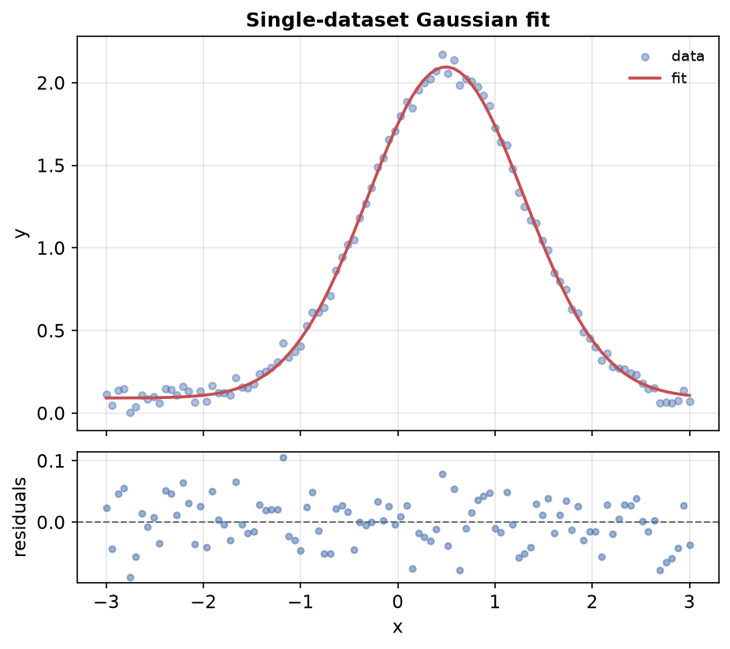

## N-Dimensional (≥3-D) Fitting

A genuinely 3-D Gaussian recovered in one joint solve, viewed through three fixed-axis slice projections.

Script: [`3d_fitting.py`](3d_fitting.py) · page in the source: `docs/tutorials/gallery/3d_fitting.md`

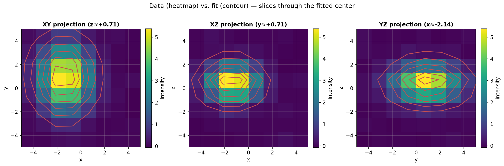

## 1-D example: local peaks with a shared line width

Two 1-D peaks fitted jointly with one shared line width, and four 2-D maps fitted jointly with a shared peak center and width.

Script: [`multi_dataset_1d.py`](multi_dataset_1d.py) · page in the source: `docs/tutorials/gallery/multi_dataset.md`

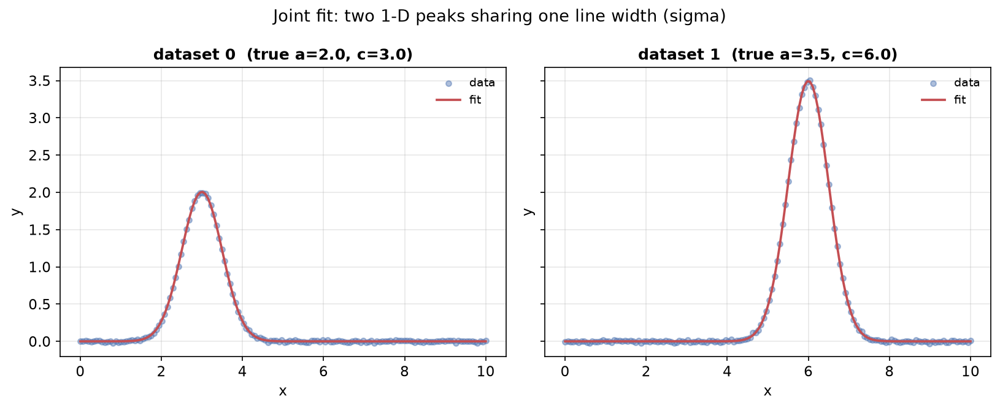

## 2-D multi-spectrum example: four different maps sharing center and width

Two 1-D peaks fitted jointly with one shared line width, and four 2-D maps fitted jointly with a shared peak center and width.

Script: [`multi_dataset_2d.py`](multi_dataset_2d.py) · page in the source: `docs/tutorials/gallery/multi_dataset.md`

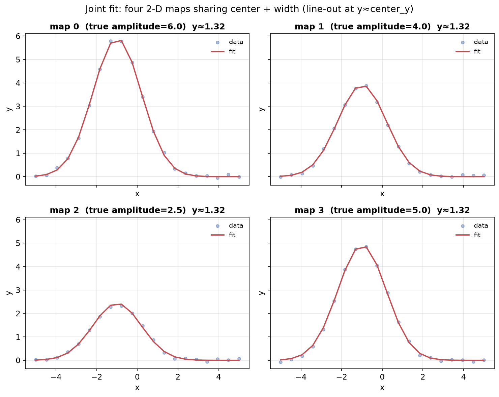

## Shared Parameters Across Peaks

Two overlapping peaks tied to an identical line width via an ExprEdge, with the shared width annotated on the plot.

Script: [`shared_params.py`](shared_params.py) · page in the source: `docs/tutorials/gallery/shared_params.md`

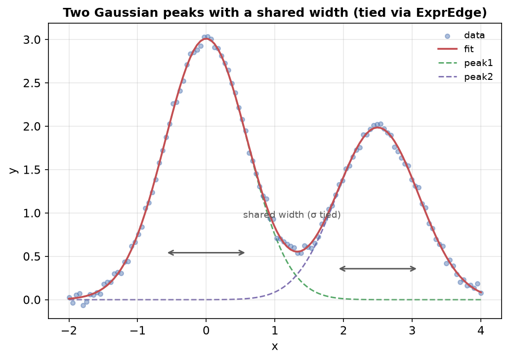

## VarPro vs. Levenberg-Marquardt

The same separable two-peak fit solved by both the VarPro and Levenberg-Marquardt solvers, converging to the identical optimum from a smaller nonlinear-only parameter space.

Script: [`varpro_vs_lm.py`](varpro_vs_lm.py) · page in the source: `docs/tutorials/gallery/varpro_vs_lm.md`

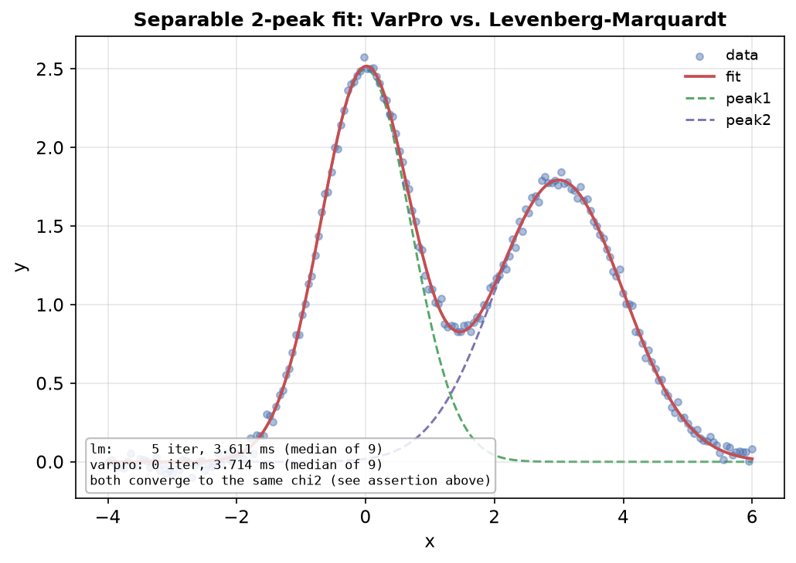

## Parameter Confidence Intervals

Turning each fitted parameter's stderr into a 95% confidence interval, annotated directly on the plot.

Script: [`confidence_intervals.py`](confidence_intervals.py) · page in the source: `docs/tutorials/gallery/confidence_intervals.md`

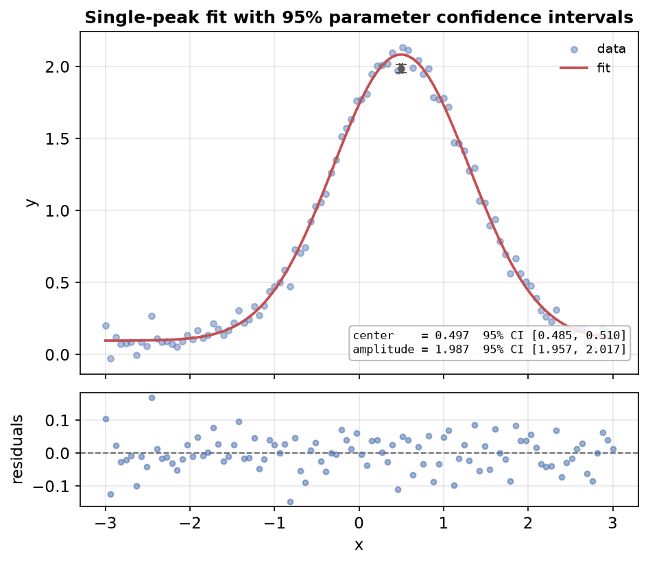

## Holding a Parameter Fixed

Holding a background level fixed at a value known from an independent measurement, instead of fitting it.

Script: [`fixed_params.py`](fixed_params.py) · page in the source: `docs/tutorials/gallery/fixed_params.md`

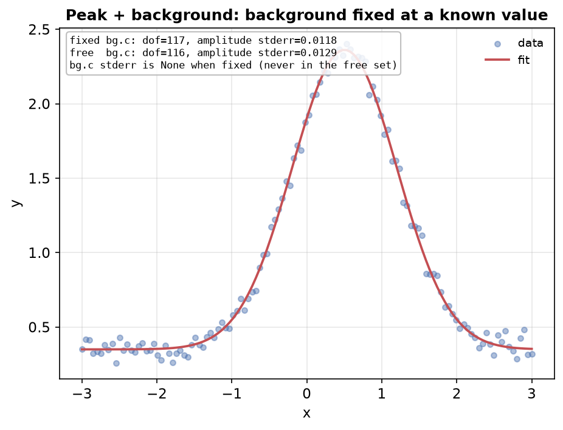

## Sigma-Weighted Fitting

Passing known per-point uncertainty as sigma so the fit weights points by their actual reliability instead of treating every point as equally trustworthy.

Script: [`weighted_fitting.py`](weighted_fitting.py) · page in the source: `docs/tutorials/gallery/weighted_fitting.md`

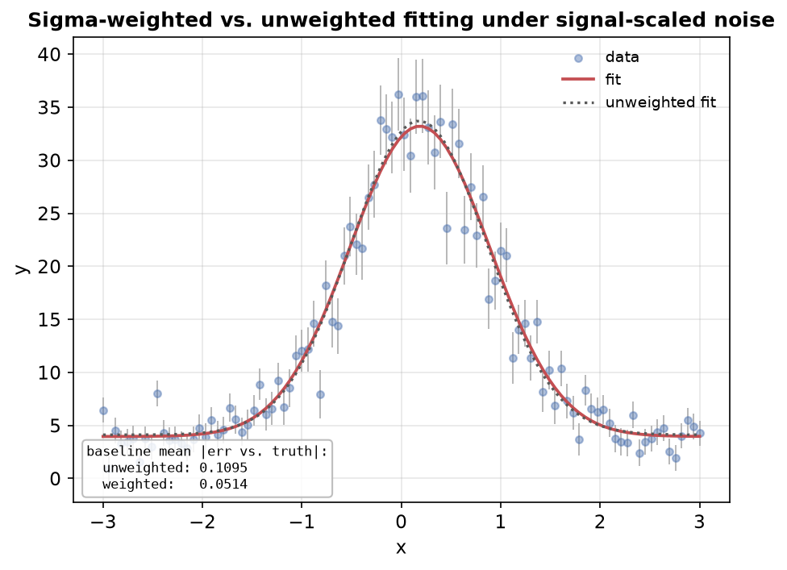

## Bounded Fitting with `lm` and `trf`

A likely-active one-sided physical bound (amplitude >= 0). trf scales steps only for parameters with two finite bounds, so here lm and trf take the same steps and both stay bound-compliant.

Script: [`bounded_fitting.py`](bounded_fitting.py) · page in the source: `docs/tutorials/gallery/bounded_fitting.md`

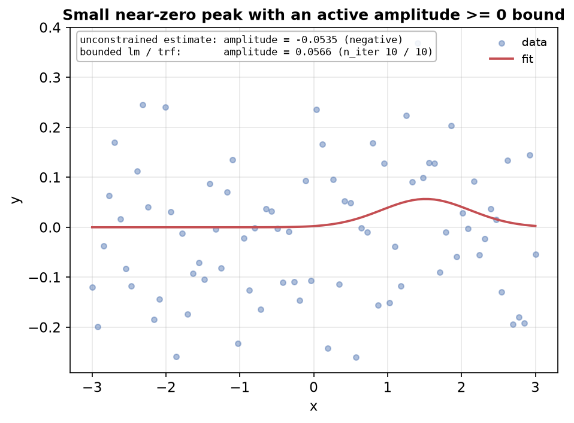

## Robust Fitting Against Outliers

A handful of corrupted spike points down-weighted automatically by irls:bisquare, instead of dragging a plain least-squares fit off the true peak.

Script: [`robust_fitting.py`](robust_fitting.py) · page in the source: `docs/tutorials/gallery/robust_fitting.md`

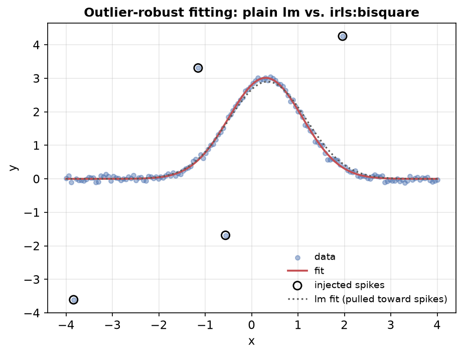

## Escaping Local Minima with the Global Solver

A deliberately bad initial guess where the global solver explores broadly before a local solver would just get stuck.

Script: [`global_optimizer.py`](global_optimizer.py) · page in the source: `docs/tutorials/gallery/global_optimizer.md`

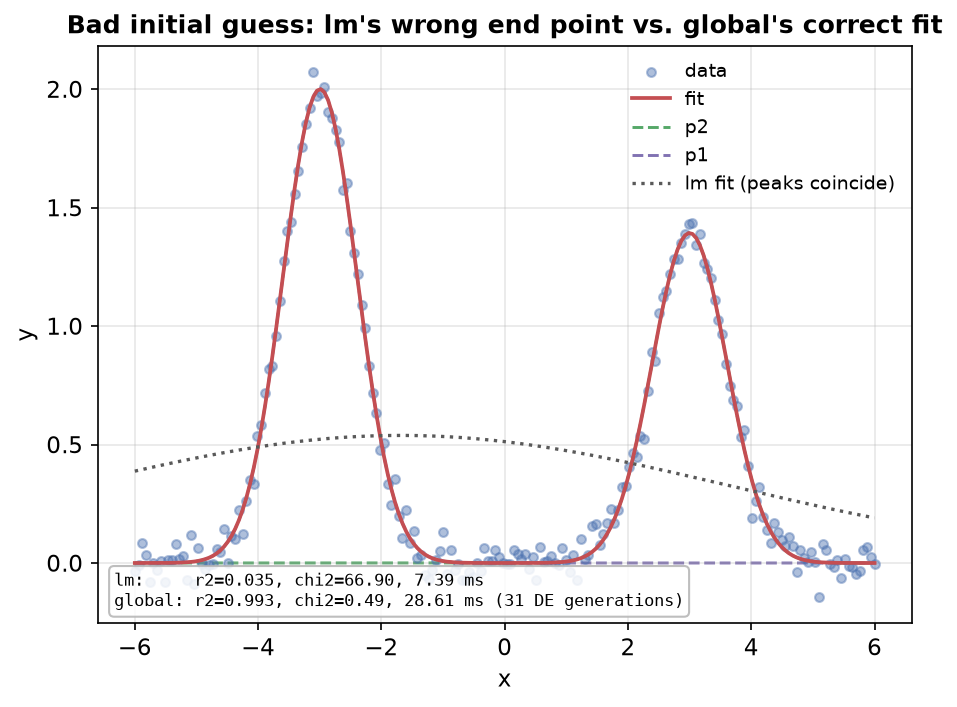

## When a Fit Fails

A fit that reports success=False and names the reason, and a worse one that reports success=True with a negative r-squared, because the degeneracy guard is deliberately narrow.

Script: [`failed_fit.py`](failed_fit.py) · page in the source: `docs/tutorials/gallery/failed_fit.md`

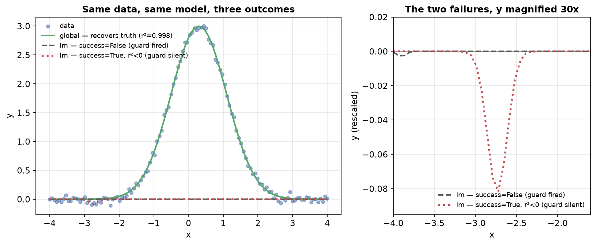

## A Wrong Model with a Good $r^2$

A model that is simply wrong, fitted to real measured data — r-squared climbs to 0.97 and AIC falls by 551 while the residual stays structured at every step.

Script: [`misspecified_model.py`](misspecified_model.py) · page in the source: `docs/tutorials/gallery/misspecified_model.md`

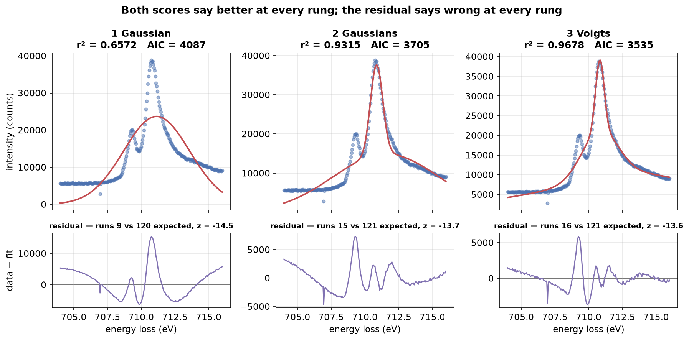

Not run by `reproduce.py --examples`: the script reads a measured spectrum from the root of a spectrafit-core checkout, outside this folder. The `gallery` target runs it with that spectrum copied from the release export (`--spectrum-dir`).

## spectrafit vs. lmfit: a moderately complex spectrum

Four overlapping peaks of mixed shape on a sloped background, fitted independently by spectrafit-core and a hand-built lmfit composite — agreeing to within 4e-6.

Script: [`spectrafit_vs_lmfit_moderate.py`](spectrafit_vs_lmfit_moderate.py) · page in the source: `docs/tutorials/gallery/spectrafit_vs_lmfit_moderate.md`

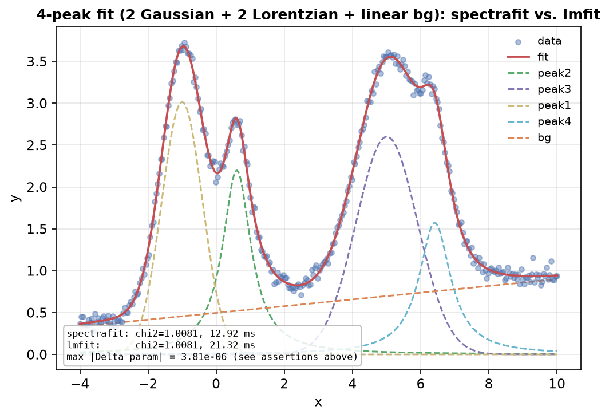

## spectrafit vs. lmfit: a complex, 8-peak spectrum

An XPS-style, 8-peak, three-lineshape spectrum with a tied spin-orbit doublet linewidth — spectrafit and lmfit converge to matching R-squared, honestly reported rather than overclaimed.

Script: [`spectrafit_vs_lmfit_complex.py`](spectrafit_vs_lmfit_complex.py) · page in the source: `docs/tutorials/gallery/spectrafit_vs_lmfit_complex.md`

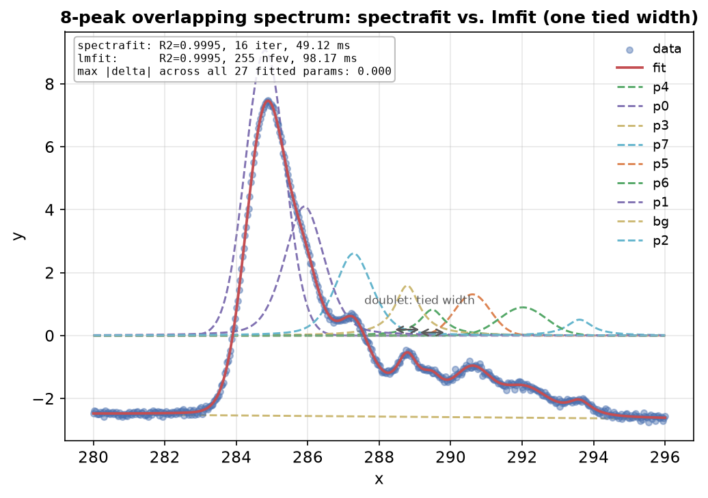
